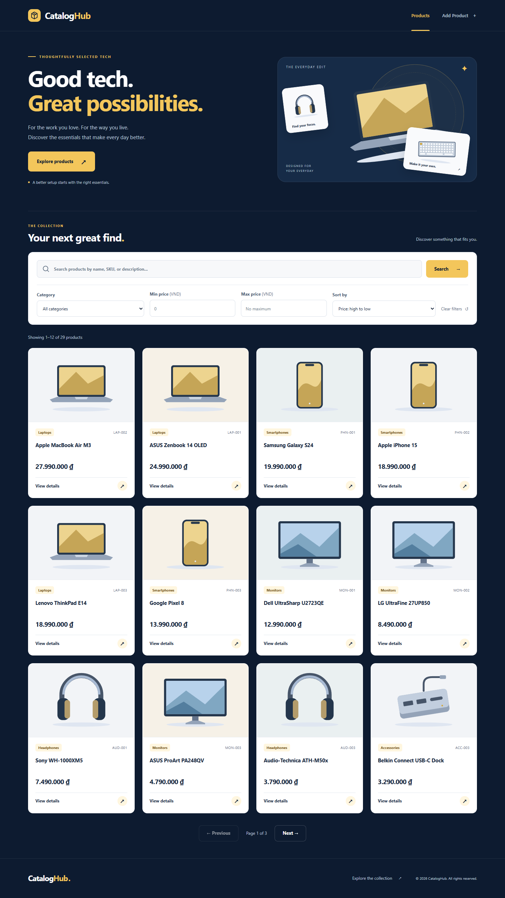

# CatalogHub

Ứng dụng quản lý và tra cứu danh mục sản phẩm công nghệ. Giao diện sử dụng navy, trắng và vàng; hỗ trợ desktop, tablet và điện thoại.

## Chức năng

- Tìm theo tên, SKU và mô tả sản phẩm.
- Lọc danh mục, khoảng giá; sắp xếp và phân trang.
- Xem chi tiết và thêm sản phẩm với kiểm tra dữ liệu đầu vào.
- Lưu dữ liệu trong MySQL, cung cấp REST API cùng origin với giao diện.

Hệ thống hiện chưa có đăng nhập hoặc phân quyền người dùng. `ENABLE_PRODUCT_WRITE` bật/tắt chức năng thêm sản phẩm cho toàn bộ ứng dụng. Đặt biến này thành `false` khi public ngoài buổi demo có kiểm soát.

## Công nghệ

Node.js 24, Express 5, EJS, CSS, JavaScript thuần, MySQL 8, mysql2 và Zod.
Kiểm thử sử dụng Node test runner, supertest và Playwright.

## Bắt đầu trên máy mới

1. Clone repository nhóm đã chia sẻ, mở terminal tại thư mục chứa `package.json`.
2. Cài Node.js 24 và MySQL 8.0.16 trở lên.
3. Chạy `npm ci`.
4. Sao chép `.env.example` thành `.env`.
5. Tạo database `cataloghub`, import schema và seed theo [LOCAL_SETUP.md](docs/LOCAL_SETUP.md).
6. Điền thông tin MySQL trên máy của bạn vào `.env`.
7. Chạy `npm run db:check`, sau đó `npm run dev`.
8. Mở <http://localhost:3000>.

PowerShell:

```powershell
npm.cmd ci
Copy-Item .env.example .env
# Hoàn tất bước tạo DB và cấu hình .env theo docs/LOCAL_SETUP.md
npm.cmd run db:check
npm.cmd run dev
```

macOS/Linux dùng `npm` và `cp .env.example .env`.
Chỉ sao chép template khi chưa có `.env`. Không commit mật khẩu hoặc sao chép `.env` của người khác.
Mỗi thành viên dùng MySQL riêng trên máy mình; Workbench là công cụ xem và quản lý server đó.

## Lệnh phát triển

| Lệnh | Mục đích |
|---|---|
| `npm ci` | Cài dependencies theo lockfile |
| `npm run dev` | Chạy và tự khởi động lại khi sửa backend |
| `npm start` | Chạy server bằng Node |
| `npm run db:check` | Kiểm tra kết nối và số bản ghi |
| `npm run db:import -- schema` | Import schema bằng tài khoản có quyền setup |
| `npm run db:import -- seed` | Import dữ liệu mẫu có chủ đích |
| `npm test` | Unit, API contract và lifecycle, không cần DB đang chạy |
| `npm run test:integration` | Kiểm thử trên database test riêng |
| `npm run test:browser` | Kiểm tra giao diện bằng Chrome và MySQL test |

Database mới seed có 8 danh mục và 24 sản phẩm minh họa. Giá lưu bằng DECIMAL và trả JSON dạng string.
MySQL session và API sử dụng UTC; trang chi tiết hiển thị thời gian UTC+7.

## Cấu trúc

```text
database/      Schema SQL, seed và hướng dẫn dữ liệu
docs/          Yêu cầu, kiến trúc, API, setup, kiểm thử, deploy
public/        CSS, JavaScript và SVG local
scripts/       Công cụ import/check DB và kiểm tra trình duyệt
src/           Config, routes, controllers, services, repositories, views
tests/         Unit, API contract, integration và lifecycle
```

## Tài liệu

- [Setup từng bước và xử lý lỗi](docs/LOCAL_SETUP.md)
- [Yêu cầu sản phẩm](docs/PRD.md)
- [Kiến trúc và hướng dẫn mở rộng](docs/ARCHITECTURE.md)
- [Hợp đồng API](docs/API.md)
- [Schema và dữ liệu mẫu](database/README.md)
- [Kiểm thử](docs/TEST_PLAN.md)
- [Làm việc nhóm bằng Git](CONTRIBUTING.md)
- [Triển khai Railway](docs/RAILWAY_DEPLOYMENT.md)

## Giao diện



[Catalog mobile](docs/screenshots/catalog-375.png) · [Form desktop](docs/screenshots/add-product-1440.png) · [Form mobile](docs/screenshots/add-product-375.png)
