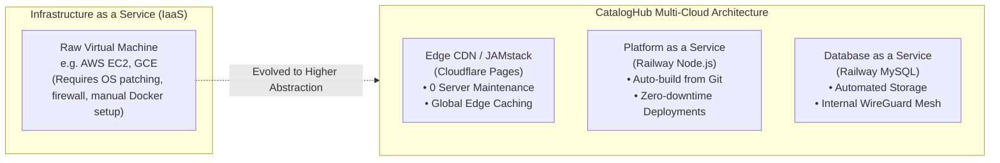
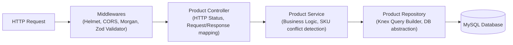

# 🏗️ CatalogHub - Production Cloud & System Architecture

This document provides a comprehensive technical overview of the system architecture, cloud service models, network topology, cost analysis, and software design patterns used in **CatalogHub**.

---

## 1. High-Level Architecture Overview

CatalogHub employs a decoupled, multi-cloud architecture engineered to deliver sub-50ms latency, high availability, zero hosting costs, and defense-in-depth security.

```mermaid
flowchart TD
    User["🌐 End User (Web Browser)"]

    subgraph Cloudflare["☁️ Cloudflare Global Edge Network"]
        CF_CDN["Cloudflare Pages (Global CDN)"]
        CF_Edge["SSL / DDoS Shield / 300+ Edge Locations"]
        StaticBundle["React 18 SPA (Vite + Tailwind CSS)\nOptimized Build in /dist"]
    end

    subgraph Railway["🚂 Railway.app Cloud Platform"]
        subgraph PublicZone["Public Facing Zone"]
            NodeAPI["NodeJS Express Service (Container)\nLayered Architecture (Controller-Service-Repo)\nPort: 5000"]
        end

        subgraph PrivateMesh["Private Network Mesh (railway.internal)"]
            MySQLDB[("MySQL 8.0 Database\nmysql.railway.internal:3306\nManaged by Knex Migrations")]
        end
    end

    User -->|HTTPS: 443| CF_Edge
    CF_Edge --> CF_CDN
    CF_CDN --> StaticBundle

    User -->|REST API JSON (HTTPS: 443)| NodeAPI
    NodeAPI -->|Private Mesh / Encrypted WireGuard| MySQLDB
```

---

## 2. Cloud Service Models (NIST Classification)

In modern Cloud Computing, services are classified according to the level of abstraction they provide:



| Component | Cloud Provider | Cloud Model | Responsibilities & Abstraction Level |
| :--- | :--- | :--- | :--- |
| **Frontend Web** | **Cloudflare Pages** | **Edge CDN / Jamstack** | Code is distributed across 300+ Edge locations. Zero cold starts, automatic SSL termination, and unlimited DDoS protection without managing servers. |
| **Backend REST API** | **Railway.app** | **PaaS (Platform as a Service)** | Automatic Nixpacks containerization from Git commits, healthcheck-driven rollbacks, and automatic environment provisioning. |
| **Database** | **Railway.app** | **DBaaS (Database as a Service)** | Managed MySQL 8.0 instance with persistent volumes, zero public attack surface, and private inter-service DNS. |
| **Inter-Service Mesh** | **Railway Private Network** | **SDN (Software-Defined Network)** | Encrypted WireGuard virtual mesh linking the backend container and database without traversing public transit. |

---

## 3. Cost & Performance Optimization Analysis

A primary objective in Cloud Architecture is optimizing the cost-to-performance ratio:

| Metric | Traditional IaaS (e.g. AWS EC2 + RDS) | CatalogHub Architecture (Cloudflare + Railway) |
| :--- | :--- | :--- |
| **Compute Cost** | \$15 - \$30 / month (t3.micro + RDS db.t3.micro) | **\$0.00 / month** (Within Railway Free/Hobby Tier & Cloudflare Free) |
| **Bandwidth (Egress)** | Charged per GB (\$0.09/GB on AWS) | **Free unlimited egress** on Cloudflare Pages; intra-mesh transit on Railway is unbilled |
| **Global Latency** | High for clients far from the single EC2 region (150-300ms) | **Sub-50ms** static asset delivery via Cloudflare Edge PoPs worldwide |
| **Maintenance Overhead** | High (Linux security patches, firewall iptables, manual SSL renewals) | **Zero** (Serverless/Managed by Cloud Providers) |

---

## 4. Software Architecture (Layered Architecture Pattern)

The backend follows the enterprise **Layered Architecture (N-Tier)**:



### Layer Breakdown:
1. **Schema Layer ([server/src/schemas/product.schema.js](../server/src/schemas/product.schema.js)):** Defines strict runtime schema validation using **Zod**. Rejects malformed requests before they hit controllers.
2. **Controller Layer ([server/src/controllers/product.controller.js](../server/src/controllers/product.controller.js)):** Responsible solely for HTTP handling, invoking appropriate services, and returning formatted JSON responses.
3. **Service Layer ([server/src/services/product.service.js](../server/src/services/product.service.js)):** Contains pure business logic (e.g., verifying SKU uniqueness before creation, orchestrating health metrics).
4. **Repository Layer ([server/src/repositories/product.repository.js](../server/src/repositories/product.repository.js)):** Encapsulates SQL data access using Knex query builder, ensuring complete protection against SQL Injection.
5. **Database Migrations ([server/src/database/migrations/](../server/src/database/migrations/)):** Managed via **Knex.js**, providing version-controlled, reversible database evolutions (`knex_migrations` tracking table).

---

## 5. Database Migration Strategy (Flyway-Equivalent in Node.js)

In the Java Spring ecosystem, **Flyway** is used to manage database versioning. In Node.js, **Knex.js Migrations** is the industry standard equivalent:

| Feature | Java Spring (Flyway) | Node.js (Knex.js Migrations) |
| :--- | :--- | :--- |
| **Tracking Table** | `flyway_schema_history` | `knex_migrations` & `knex_migrations_lock` |
| **Forward Migration** | `V1__init.sql` | `20240101000000_create_products_table.js` (`up`) |
| **Rollback Capability** | Flyway Teams / Undo scripts | `knex migrate:rollback` (`down`) |
| **CLI Commands** | `flyway:migrate` | `npm run migrate` |
| **Automated On-Boot** | Runs automatically on Spring context boot | Executed during `server.js` bootstrap (`db.migrate.latest()`) |

---

## 6. Frontend Architecture & Edge Delivery

* **Framework:** React 18 with Vite
* **Styling:** Tailwind CSS with utility-first responsive layout
* **Icons:** Lucide React
* **Hosting:** Cloudflare Pages (Instant globally distributed Edge CDN)
* **Single Page Application Routing:** Powered by `client/public/_redirects` (`/* /index.html 200`) ensuring seamless client-side routing on Cloudflare Edge nodes.
