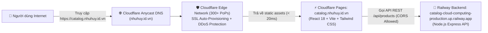

# ⚡ Hướng Dẫn Chi Tiết Triển Khai Frontend Lên Cloudflare Pages & Gắn Custom Domain

Tài liệu này hướng dẫn toàn diện các bước cấu hình, tối ưu hóa và triển khai giao diện **React 18 + Vite + TypeScript (SPA)** lên nền tảng **Cloudflare Pages**, kết hợp chuyển quyền quản trị DNS từ nhà đăng ký iNET sang Cloudflare và gắn tên miền tùy chỉnh chính thức **`catalog.nhuhuy.id.vn`**.

---

## 📑 Mục lục
1. [Tổng quan kiến trúc & Yêu cầu chuẩn bị](#1-tổng-quan-kiến-trúc--yêu-cầu-chuẩn-bị)
2. [Bước 1: Kết nối Repo GitHub vào Cloudflare Pages](#bước-1-kết-nối-repo-github-vào-cloudflare-pages)
   * [Lưu ý quan trọng: Phân biệt giữa Pages và Workers (Tránh lỗi `wrangler`)](#lưu-ý-quan-trọng-phân-biệt-giữa-pages-và-workers-tránh-lỗi-wrangler)
3. [Bước 2: Cấu hình Build Settings cho kiến trúc Monorepo](#bước-2-cấu-hình-build-settings-cho-kiến-trúc-monorepo)
4. [Bước 3: Thiết lập Biến Môi Trường (Environment Variables)](#bước-3-thiết-lập-biến-môi-trường-environment-variables)
5. [Bước 4: Triển khai & Kiểm tra phân phối toàn cầu (Edge CDN)](#bước-4-triển-khai--kiểm-tra-phân-phối-toàn-cầu-edge-cdn)
6. [Bước 5: Cấu hình DNS & Gắn Custom Domain `catalog.nhuhuy.id.vn`](#bước-5-cấu-hình-dns--gắn-custom-domain-catalognhuhuyidvn)
   * [5.1. Chuyển quyền quản trị Nameserver từ iNET sang Cloudflare](#51-chuyển-quyền-quản-trị-nameserver-từ-inet-sang-cloudflare)
   * [5.2. Các bước gắn subdomain `catalog.nhuhuy.id.vn`](#52-các-bước-gắn-subdomain-catalognhuhuyidvn)
   * [5.3. Kích hoạt tự động CNAME & Cấp chứng chỉ SSL/TLS](#53-kích-hoạt-tự-động-cname--cấp-chứng-chỉ-ssltls)
7. [Bước 6: Cấu hình SPA Routing chống lỗi 404 (`_redirects`)](#bước-6-cấu-hình-spa-routing-chống-lỗi-404-_redirects)
8. [Bước 7: Đồng bộ cấu hình CORS trên Backend Railway](#bước-7-đồng-bộ-cấu-hình-cors-trên-backend-railway)
9. [Kiểm thử nghiệm thu End-to-End (Verification)](#kiểm-thử-nghiệm-thu-end-to-end-verification)

---

## 1. Tổng quan kiến trúc & Yêu cầu chuẩn bị



### Yêu cầu tiên quyết:
* Tài khoản [Cloudflare](https://dash.cloudflare.com).
* Tên miền gốc `nhuhuy.id.vn` đã sở hữu tại nhà đăng ký iNET/VNNIC.
* Tên miền công khai của Backend Railway đã triển khai:
  `https://catalog-cloud-computing-production.up.railway.app`
* Mã nguồn Frontend hoàn thiện tại thư mục `/client` trên nhánh **`develop`**.

---

## Bước 1: Kết nối Repo GitHub vào Cloudflare Pages

1. Đăng nhập vào [Cloudflare Dashboard](https://dash.cloudflare.com).
2. Tại thanh điều hướng bên trái, chọn **Workers & Pages**.
3. Bấm nút **Create application**.

> [!WARNING]
> ### Lưu ý quan trọng: Phân biệt giữa Pages và Workers (Tránh lỗi `wrangler`)
> Giao diện mới của Cloudflare có thể hiển thị trang chọn mẫu *"Make something new"* hoặc dẫn vào luồng tạo **Worker**:
> * Nếu bạn thấy màn hình yêu cầu chạy `npx wrangler deploy` và đòi tạo `API token` $\rightarrow$ **Đó là luồng dành cho backend serverless, KHÔNG PHÙ HỢP với frontend React tĩnh**.
> * **Giải pháp chuẩn:** Nhìn xuống bên dưới khung trắng, bấm vào đường link:
>   👉 **`Need to use the legacy Pages workflow? Continue to Pages`** (hoặc chọn tab **Pages** $\rightarrow$ bấm **Connect to Git**).

4. Cấp quyền cho Cloudflare liên kết với tài khoản GitHub và chọn repository: `catalog-cloud-computing`.
5. Bấm **Begin setup**.

---

## Bước 2: Cấu hình Build Settings cho kiến trúc Monorepo

Do dự án là **Monorepo** chia thành 2 thư mục độc lập `client/` và `server/`, bạn điền chính xác các thông số như bảng sau:

| Trường cấu hình | Giá trị thiết lập | Giải thích kỹ thuật |
| :--- | :--- | :--- |
| **Project name** | `catalog-client` *(hoặc `catalog-cloud-computing`)* | Tên dự án (Cloudflare sẽ cấp domain mặc định `*.pages.dev`) |
| **Production branch** | ⚠️ **`develop`** | **Bắt buộc chọn `develop`** (nhánh chứa toàn bộ mã nguồn React 18, Vite, Tailwind và TypeScript mới nhất) |
| **Framework preset** | **`Vite`** | Chọn preset Vite để Cloudflare áp dụng quy trình build tối ưu nhất |
| **Root directory** | ⚠️ **/client** (hoặc `client`) | **Bắt buộc**: Báo cho Cloudflare chuyển vào thư mục frontend, tìm đúng `client/package.json` |
| **Build command** | `npm run build` | Thực thi lệnh biên dịch `tsc -b && vite build` |
| **Build output directory** | `dist` | Thư mục đầu ra chứa các tệp HTML, JS, CSS sau khi đóng gói |

---

## Bước 3: Thiết lập Biến Môi Trường (Environment Variables)

Mở rộng mục **Environment variables (advanced)** ngay phía dưới:

1. Bấm **Add variable** và thêm 2 biến sau:

| Tên biến (Variable name) | Giá trị (Value) | Mục đích |
| :--- | :--- | :--- |
| **`VITE_API_BASE_URL`** | `https://catalog-cloud-computing-production.up.railway.app` | URL công khai của Backend Railway *(⚠️ Không để dấu gạch chéo `/` ở cuối)* |
| **`NODE_VERSION`** | `20` | Khuyến nghị để Cloudflare dùng runtime Node.js 20 đồng nhất |

---

## Bước 4: Triển khai & Kiểm tra phân phối toàn cầu (Edge CDN)

1. Bấm nút **Save and Deploy**.
2. Cloudflare Pages sẽ khởi chạy container, kéo mã nguồn, chạy `npm install`, biên dịch TypeScript và đóng gói Vite trong khoảng **30 – 45 giây**.
3. Sau khi hoàn thành, bạn sẽ nhận được một đường link mặc định:
   ```text
   https://catalog-client.pages.dev
   ```

---

## Bước 5: Cấu hình DNS & Gắn Custom Domain `catalog.nhuhuy.id.vn`

### 5.1. Chuyển quyền quản trị Nameserver từ iNET sang Cloudflare
Để Cloudflare có toàn quyền cấp phát SSL tự động và phân phối lưu lượng qua CDN:
1. Thêm domain `nhuhuy.id.vn` vào Cloudflare $\rightarrow$ Cloudflare chỉ định 2 máy chủ Nameserver riêng:
   * `gene.ns.cloudflare.com`
   * `harlan.ns.cloudflare.com`


2. Đăng nhập trang quản trị tên miền iNET (`sso.inet.vn`) $\rightarrow$ vào phần **Cập nhật DNS / Thay đổi Nameserver**:
   * Nhập 2 địa chỉ của Cloudflare: `gene.ns.cloudflare.com` và `harlan.ns.cloudflare.com`.
   * Xóa bỏ các nameserver cũ (`catba.vclouddns.com`, `haiphong.vclouddns.com`).
   * Bấm **Cập nhật DNS** để lưu thay đổi.


3. Chờ hệ thống phân giải tên miền toàn cầu (DNS Propagation) đồng bộ (khoảng 10–30 phút):


---

### 5.2. Các bước gắn subdomain `catalog.nhuhuy.id.vn`
Khi domain `nhuhuy.id.vn` đã Active trên Cloudflare:
1. Trong Cloudflare Dashboard, vào **Workers & Pages** $\rightarrow$ chọn dự án `catalog-cloud-computing`.
2. Chọn tab **Custom domains** trên thanh menu.
3. Bấm nút **Set up a custom domain**.
4. Nhập chính xác tên miền con: **`catalog.nhuhuy.id.vn`**.
5. Bấm **Continue** $\rightarrow$ bấm **Activate domain**.

---

### 5.3. Kích hoạt tự động CNAME & Cấp chứng chỉ SSL/TLS
* Cloudflare tự động tạo bản ghi DNS **CNAME** (`catalog.nhuhuy.id.vn` trỏ tới `catalog-cloud-computing.pages.dev`).
* Hệ thống tự động cấp phát chứng chỉ **Universal SSL/TLS** (HTTPS miễn phí).
* Trạng thái miền hiển thị **`Active` (chấm xanh)** và **`SSL enabled` (ổ khóa)**:


---

## Bước 6: Cấu hình SPA Routing chống lỗi 404 (`_redirects`)

Trong các ứng dụng React Single Page Application (SPA), routing được xử lý ở phía trình duyệt (Client-side routing bằng React Router). 

Nếu không có cấu hình rewrite trên web server:
* Người dùng truy cập trang chủ `https://catalog.nhuhuy.id.vn` $\rightarrow$ Tải thành công.
* Người dùng truy cập đường dẫn con hoặc bấm F5 tải lại tại `https://catalog.nhuhuy.id.vn/add` $\rightarrow$ Máy chủ Cloudflare sẽ báo lỗi **404 Not Found** vì trên disk không có file vật lý tên là `add`.

### ✅ Giải pháp đã tích hợp:
Mã nguồn dự án tại thư mục [client/public/_redirects](file:///d:/My%20Folder/Cloud%20Computing/CatalogHub_cloudComputing/client/public/_redirects) đã chứa nội dung:
```text
/*    /index.html   200
```
Khi Vite build, tệp này được sao chép trực tiếp vào thư mục đầu ra `dist/_redirects`. Máy chủ Cloudflare Pages đọc tệp này và tự động điều hướng mọi request URL về `index.html` với mã trạng thái `200 OK`, giúp React Router điều hướng trơn tru mà không bao giờ bị lỗi 404.

---

## Bước 7: Đồng bộ cấu hình CORS trên Backend Railway

Sau khi Frontend đã có tên miền chính thức, bạn cần cập nhật cấu hình bảo mật Cross-Origin Resource Sharing (CORS) trên Backend:

1. Đăng nhập [Railway Dashboard](https://railway.app) $\rightarrow$ chọn service **Backend**.
2. Chuyển sang tab **Variables**:
   * Cập nhật biến `CLIENT_ORIGIN`:
     ```env
     CLIENT_ORIGIN=https://catalog.nhuhuy.id.vn
     ```
3. Backend Express sẽ tự động reload chỉ sau vài giây.
4. Đoạn mã middleware CORS trong `server/src/app.ts` sẽ chính thức cấp phép cho nguồn gốc `https://catalog.nhuhuy.id.vn` được quyền gửi các request GET, POST, PUT, DELETE vào máy chủ API.

---

## Kiểm thử nghiệm thu End-to-End (Verification)

Mở trình duyệt và truy cập vào tên miền chính thức:
👉 **[https://catalog.nhuhuy.id.vn](https://catalog.nhuhuy.id.vn)**

### Tiêu chí nghiệm thu hệ thống:
1. **Kiểm tra HTTPS & Tốc độ tải trang:**
   * Trình duyệt hiển thị biểu tượng ổ khóa an toàn (Chứng chỉ SSL hợp lệ từ Cloudflare).
   * Thời gian nạp trang đầu tiên dưới 100ms nhờ mạng lưới Edge CDN.
2. **Kiểm tra Kết nối Backend API:**
   * Góc trên cùng bên phải thanh Header xuất hiện chấm xanh phát sáng với trạng thái:
     **`Railway Live (XXms)`** (Đã ping thành công tới `GET /api/health` của Railway).
3. **Kiểm tra Nghiệp vụ Dữ liệu:**
   * Danh sách 6 sản phẩm mẫu từ MySQL hiển thị đầy đủ thông tin: hình ảnh, tên sản phẩm, danh mục, giá bán và số lượng tồn kho.
   * Thử tìm kiếm sản phẩm bằng thanh Search: Danh sách cập nhật tức thì theo từ khóa.
   * Thử lọc theo từng danh mục (Laptops, Smartphones, Accessories,...).
   * Bấm nút **"Thêm sản phẩm mới"** $\rightarrow$ Điền thông tin và bấm Submit $\rightarrow$ Sản phẩm mới được ghi thành công vào Database MySQL trên Railway và lập tức hiển thị lên giao diện.
4. **Kiểm tra F5 Trang con (SPA Routing):**
   * Đang ở trang bất kỳ, bấm F5 tải lại trang $\rightarrow$ Trang tải lại bình thường, không xuất hiện lỗi 404.
